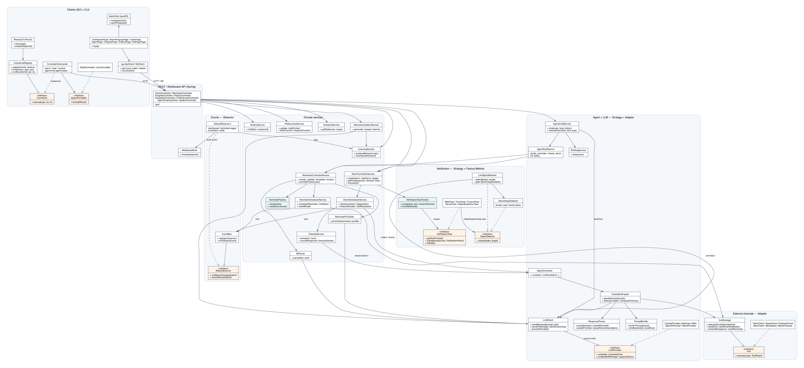

# RiseUp — Stage 2 Implementation Docs

**Course:** EECS3311 · **Period:** 20 Oct – 10 Nov 2026  
**Repository:** [https://github.com/Ghosts6/RiseUp](https://github.com/Ghosts6/RiseUp)  
**Branches:** `main` (Python/FastAPI + React baseline) · `migrate/java` (Java delivery stack)

This document is the working Stage 2 write-up for the requirements in `Project-Stage2-Instruction.pdf`. It feeds the final `stage2-report` PDF and sits beside [java-migration-notes.md](./java-migration-notes.md).

---

## 1. Project overview and implementation status

### Application

**RiseUp** is an intelligent alarm and reminder system. Users manage alarms with verification challenges, post-wake check-ins, multi-channel escalation when they miss wake-up, natural-language reminders, prioritization, behavioral learning, analytics, and recommendations. An in-app AI agent can answer questions, give a morning briefing, and create alarms or reminders after the user confirms.

**Users:** individuals who need reliable wake-up and task follow-through (personal productivity / accountability).

### AI / LLM integration (in-product)

Every AI call goes through `LLMClient`, which routes each task to a configured `LLMProvider` (Strategy). Defaults below; each route is configurable in `backend/.env`. If a provider is missing or fails, the feature uses a documented rule-based fallback and records that it did.

| Role | Default provider / model | Agent behaviour | Fallback |
|------|--------------------------|-----------------|----------|
| Escalation decision (F04) | Claude `claude-sonnet-5` | Reads profile + recent escalation history, decides method / timing / message with reasoning + confidence | Rule ladder (call → SMS → Alexa → contact) |
| NL reminder parse (F07) | OpenAI `gpt-6-luna` | Extracts title / due / priority / category, asks a clarifying question when ambiguous | Manual form pre-filled |
| Reminder prioritization (F09) | Claude `claude-sonnet-5` | Ranks due reminders using priority, time and completion rates | Sort by priority → category → due |
| Recommendations (F13) | Claude `claude-sonnet-5` | Turns learned stats into validated setting changes | Rule-based tips |
| Photo verification (F02) | Claude `claude-sonnet-5` (vision) | Checks the photo really shows the requested object; explains what it saw when rejecting | Local format / size / blank check, labelled "AI vision unavailable" |
| Agent chat with tools (F15) | OpenAI `gpt-6-luna` | Multi-turn chat grounded in app knowledge + user's local time; proposes `create_alarm` / `create_reminder` / `list_today` tool calls, executed only after user confirmation | Error message; no action taken |
| Daily briefing (F16) | Deterministic (rules) | Summarises today's alarms, open tasks, high-priority items and pending check-ins | — |

Keys live in local `backend/.env` (never committed); placeholders mean mock mode. `GET /api/health` shows which provider each route is using. See README for setup.

### Current stack (submitted direction)

| Layer | Implementation |
|-------|------------------|
| API | Spring Boot 3, JPA, Flyway, WebSocket `/ws` |
| AI | Anthropic Java SDK (`anthropic-java`) for Claude; OpenAI Chat Completions over `HttpClient`; `MockProvider` |
| CLI | Picocli `riseup` over HTTP (Command pattern) |
| GUI | JavaFX desktop (dashboard, alarms, ringing/verify, tasks, insights, recommendations, history, settings, agent) |
| Runtime | Docker Compose: Postgres + Redis + backend · or `./gradlew :backend:bootRun` (H2 default, reads `backend/.env`) |

Legacy Python FastAPI + React sources remain under `legacy/` on `migrate/java` for traceability.

### Working functionality (honest status)

**Working / demoable:** F01–F16 via API + CLI + JavaFX GUI. Real LLM calls for F02, F04, F07, F09, F13 and F15 (verified live against Claude Sonnet 5 / gpt-6-luna), mock providers when keys are absent; verification strategies (math / trivia / custom / multi-question series / AI photo check); escalation with tool adapters; prefs / contacts with consent; NL reminders; prioritization; learning + analytics; recommendations; history with decision explanations; Observer event bus pushing live updates to the GUI; 40 backend + 5 CLI JUnit tests.

**Limitations:**
- Twilio / Alexa / Firebase / email run through mock adapters unless real credentials are configured (the live adapters exist but were not exercised with paid accounts).
- Photo verification needs a vision-capable provider (Claude). Without it the local check only rejects corrupt, tiny or blank images, and the result says so.
- Photos are uploaded from a file (GUI file picker or CLI `--photo`); there is no live camera capture.
- Learning (F11) is statistical aggregation, not a trained model. AI personalisation happens in F04 / F09 / F13, which read the learned profile.
- GUI is desktop JavaFX; the React web UI is legacy only.

---

## 2. Feature → implementation mapping

Stage 1 proposed **F01–F14**; all are implemented. **F15** and **F16** are new. Paths are under `backend/src/main/java/com/riseup/` unless marked GUI (`gui/.../ui/pages/`) or CLI (`cli/.../cli/`).

### 2.1 Summary

| Feature | Stage 1 | Status | Type | Patterns | Video |
|---------|---------|--------|------|----------|-------|
| F01 Alarm Management | F01 | Implemented | Deterministic | Observer | §7 |
| F02 Verification Challenge | F02 | **Modified** (AI photo check, CLI photo verify, series questions) | Hybrid | Strategy, Factory Method | §7 |
| F03 Post-Wake Check-in | F03 | Implemented | Deterministic | Observer, Adapter | §7 |
| F04 AI Escalation Decision | F04 | Implemented | AI with fallback | Strategy, Adapter | §7 |
| F05 Multi-Channel Escalation | F05 | Implemented | Deterministic | Adapter | §7 |
| F06 Emergency Contact & Prefs | F06 | Implemented | Deterministic | Adapter | §7 |
| F07 NL Reminder Creation | F07 | Implemented | Hybrid | Strategy, Factory Method | §7 |
| F08 Reminder Management | F08 | Implemented | Deterministic | Factory Method, Observer | §7 |
| F09 AI Reminder Prioritization | F09 | Implemented | AI with fallback | Strategy | §7 |
| F10 Reminder Escalation Levels | F10 | Implemented | Deterministic | Observer, Adapter | §7 |
| F11 Behavioral Learning | F11 | Implemented | Deterministic | Observer | §7 |
| F12 Analytics Dashboard | F12 | Implemented | Deterministic | Strategy (CLI formatters) | §7 |
| F13 AI Recommendations | F13 | Implemented | AI with fallback | Strategy | §7 |
| F14 History & Explanation | F14 | Implemented | Hybrid | Strategy (CLI formatters) | §7 |
| F15 Agent Chat with Tool Actions | **New** | Implemented | AI (tool use, confirm-before-act) | Strategy, Command (CLI) | §7 |
| F16 Daily Briefing | **New** | Implemented | Deterministic | — | §7 |

### 2.2 Per-feature detail

**F01 — Alarm Management** · Stage 1: F01 · Implemented · Deterministic
- *Classes:* `alarm/AlarmControllerService` (validation, 20-alarm limit, CRUD); `alarm/AlarmSchedulerService` (trigger jobs); `domain/AlarmEntity`, `repository/AlarmRepository` (persistence); `api/AlarmController` (REST); GUI `AlarmFormPage`, `DashboardPage`; CLI `alarm add|list|edit|delete|toggle`.
- *Key methods:* `AlarmControllerService.createAlarm / editAlarm / toggle / delete`, `AlarmSchedulerService.scheduleAlarm`.
- *Flow:* GUI form or CLI → `POST /api/alarms` → `createAlarm()` validates time, task type and the limit → saves → `scheduleAlarm()` registers the trigger job → status events go to the dashboard over WebSocket.

**F02 — Verification Challenge** · Stage 1: F02 · **Modified** · Hybrid
- *Classes:* `verification/VerificationTask` (strategy interface) with `MathTask`, `TriviaTask`, `CustomTask`, `SeriesTask` (multi-question), `ObjectDetectionTask`; `VerificationTaskFactory` (creates the right task, falls back to math after repeated camera failures); `ObjectDetector` strategy with `LlmObjectDetector` (AI) and `BasicImageDetector` (local gate / fallback); GUI `AlarmRingingPage`; CLI `alarm challenge|verify --answer|--done|--photo`.
- *Key methods:* `VerificationTaskFactory.create / fromState`, `VerificationTask.validate`, `LlmObjectDetector.detect`, `LLMClient.sendVision`, `AlarmControllerService.getChallenge / verify`.
- *Flow:* alarm fires → `getChallenge()` asks the factory for a task → GUI shows it (photo challenges show only an upload control; Verify unlocks after a valid JPEG/PNG) → `verify()` calls `task.validate()`. For photos, `LlmObjectDetector` first runs `BasicImageDetector`, then sends the image to Claude, which returns `{present, confidence, seen}`. A wrong object is rejected with what the model saw.
- *Change:* see §4 (vision library → LLM vision; photo now also possible from the CLI).

**F03 — Post-Wake Check-in** · Stage 1: F03 · Implemented · Deterministic
- *Classes:* `alarm/CheckInService`; `tools/ToolManager` (push, SMS fallback); GUI `CheckInPage`; CLI `checkin confirm|list`.
- *Key methods:* `CheckInService.schedule / send / recordResponse / timeoutHandler`.
- *Flow:* successful verification → `schedule()` → `send()` pushes "Are you still awake?" → user confirms (`recordResponse`) or `timeoutHandler()` hands over to F04.

**F04 — AI Escalation Decision** · Stage 1: F04 · Implemented · AI with fallback
- *Classes:* `agent/AgentController` (entry point), `agent/EscalationEngine` (context, decision, validation, fallback), `ai/PromptBuilder`, `ai/LLMClient`, `ai/LLMProvider` (+ `ClaudeProvider`), `ai/ResponseParser`, `domain/EscalationLogEntity`.
- *Key methods:* `AgentController.runEscalation`, `EscalationEngine.buildContext / decideEscalation / fallbackLadder`, `PromptBuilder.buildEscalationPrompt`, `ResponseParser.parseDecision`.
- *Flow:* missed alarm or check-in → `runEscalation()` → `buildContext()` (profile stats, recent escalations, enabled methods) → prompt → Claude → `parseDecision()` checks that the method is enabled → decision with reasoning and confidence is logged and passed to F05. Timeout, invalid JSON or a disabled method → `fallbackLadder()`, logged as `fallback_used`.

**F05 — Multi-Channel Escalation Execution** · Stage 1: F05 · Implemented · Deterministic
- *Classes:* `tools/ToolManager`; `tools/Tool` (adapter interface); `TwilioClient`, `AlexaClient`, `FirebaseClient` (live) and `Mock*` clients; `EscalationEngine.scheduleFollowup`.
- *Key methods:* `ToolManager.executeEscalation / sendSms / contactEmergency`, `EscalationEngine.followup / markUnanswered`.
- *Flow:* decision → `executeEscalation(method)` → adapter → result logged → after 30 s with no response the next channel is tried; when the whole chain fails the alarm is marked unanswered.

**F06 — Emergency Contact & Escalation Preferences** · Stage 1: F06 · Implemented · Deterministic
- *Classes:* `prefs/PreferencesService`, `domain/UserPreferencesEntity`, `domain/EmergencyContactEntity`, `api/PreferencesController`; GUI `SettingsPage`; CLI `prefs show|set|test`, `contact add|list|remove|test`.
- *Key methods:* `PreferencesService.update / addContact / consentLink / respondConsent / testChannel / testContact`.
- *Flow:* settings form → `update()` validates channels and phone numbers → contacts stay excluded until consent is recorded → "test" sends through `ToolManager`.

**F07 — Natural-Language Reminder Creation** · Stage 1: F07 · Implemented · Hybrid
- *Classes:* `reminder/NlParser`, `ai/PromptBuilder`, `ai/LLMClient`, `ai/ResponseParser`, `reminder/ReminderFactory`; GUI `TasksPage` ("Fill from text") and `AgentPage`; CLI `remind "<sentence>"`.
- *Key methods:* `NlParser.parse`, `PromptBuilder.buildParsePrompt`, `ResponseParser.parseReminder`, `ReminderFactory.create`.
- *Flow:* sentence → `parse()` → LLM JSON (`ok | needs_clarification | past_time`) → deterministic date validation → user confirms → `ReminderFactory.create()` → scheduled. Ambiguous input gets a clarifying question.

**F08 — Reminder Management** · Stage 1: F08 · Implemented · Deterministic
- *Classes:* `reminder/ReminderControllerService`, `reminder/ReminderFactory`, `reminder/ReminderSchedulerService`, `repository/ReminderRepository`; GUI `TasksPage` and the dashboard "Tasks & events" card; CLI `task add|list|edit|done|snooze|delete` (`--due` also accepts `tomorrow 9am`, `in 30 minutes`).
- *Key methods:* `ReminderControllerService.create / update / complete / snooze / delete / spawnNext`, `ReminderFactory.nextOccurrence`.
- *Flow:* form or CLI → validate → save → `scheduleReminder()`; completing a recurring reminder spawns the next occurrence.

**F09 — AI Reminder Prioritization** · Stage 1: F09 · Implemented · AI with fallback
- *Classes:* `reminder/ReminderPrioritizer`, `ai/PromptBuilder`, `ai/LLMClient`, `ai/ResponseParser`; CLI `task priority-preview`.
- *Key methods:* `ReminderPrioritizer.prioritize`, `ReminderControllerService.priorityPreview`, `ResponseParser.parsePrioritize`.
- *Flow:* several reminders due → `prioritize()` → Claude ranks them with reasoning → the ranking is accepted only if every reminder appears exactly once, otherwise the deterministic sort is used. Output shows `Decided by: llm:claude` or `rules`.

**F10 — Reminder Escalation Levels** · Stage 1: F10 · Implemented · Deterministic
- *Classes:* `reminder/ReminderSchedulerService`, `tools/ToolManager`, `events/EventBus` + `DefaultObservers` (reminder logger, dashboard).
- *Key methods:* `ReminderSchedulerService.notifyDue / markMissed`, `ToolManager.sendReminder`.
- *Flow:* primary notification → re-sent at +5 min and +15 min with stronger tone → marked missed; completing the task cancels the sequence. Each status change is emitted to observers.

**F11 — Behavioral Learning & Profile Update** · Stage 1: F11 · Implemented · Deterministic
- *Classes:* `insights/LearningService`, `insights/LearningNightlyJob` (02:15 daily), `domain/UserProfileEntity`; CLI `profile show|recompute`.
- *Key methods:* `LearningService.analyzeBehavior / recomputeAllUsers`.
- *Flow:* aggregates alarm, escalation and reminder logs into a wake-hour histogram, verification stats, per-method escalation success rates and per-category completion rates; marks "insufficient" below 5 signals. F04, F09 and F13 read this profile.

**F12 — Sleep & Completion Analytics Dashboard** · Stage 1: F12 · Implemented · Deterministic
- *Classes:* `insights/AnalyticsService`, `api/InsightsController`; GUI `InsightsPage`; CLI `stats --range 7d|30d|90d [--json]`.
- *Key methods:* `AnalyticsService.getStats`.
- *Flow:* range → `getStats()` → GUI charts, or CLI table / JSON through the `OutputFormatter` strategy.

**F13 — AI Personalized Recommendations** · Stage 1: F13 · Implemented · AI with fallback
- *Classes:* `insights/RecommendationService`, `ai/PromptBuilder`, `ai/LLMClient`, `ai/ResponseParser`, `domain/RecommendationEntity`; GUI `RecommendationsPage`; CLI `recommend [--apply n | --dismiss n]`.
- *Key methods:* `RecommendationService.generate / accept / dismiss`, `PromptBuilder.buildRecommendPrompt`, `ResponseParser.parseRecommendations`.
- *Flow:* profile + current settings → Claude suggests changes → each is validated against allowed settings (unsafe ones, e.g. disabling all escalation, are dropped) → accept applies through `PreferencesService`.

**F14 — History & Decision Explanation** · Stage 1: F14 · Implemented · Hybrid
- *Classes:* `history/HistoryService`, `api/HistoryController`, `api/EscalationController`; GUI `HistoryPage`; CLI `history --type --since`, `escalation explain <id>`.
- *Key methods:* `HistoryService.list / explain`.
- *Flow:* filtered, paginated event list; `explain()` loads the stored decision (method, reasoning, confidence, provider, whether the fallback was used).

**F15 — Agent Chat with Tool Actions** · **New** · Implemented · AI
- *Classes:* `agent/AgentChatService` (intent routing, multi-turn chat, tool-proposal extraction); `agent/AgentToolService` (whitelisted tools `create_alarm`, `create_reminder`, `list_today`); `ai/PromptBuilder.chatSystem` (app knowledge + tool schema + user's local date/time); `ai/AppKnowledge`; `api/AgentChatController`; GUI `AgentPage` (chat history in `AgentChatStore`); CLI `agent chat ["message"]` (one-shot or interactive).
- *Key methods:* `AgentChatService.chat / executeTool`, `AgentToolService.execute / proposeReminderFromText`, `LLMClient.sendChat`.
- *Flow:* user message → shortcuts for "remind me…" (F07 parser) and "what's on today" (F16) → otherwise multi-turn LLM chat → if the reply ends with a tool JSON for a known tool, it is returned as `proposed_action` → GUI or CLI asks for confirmation → `POST /api/agent/tools/execute` → the same domain services as the forms (validation and limits still apply).

**F16 — Daily Briefing** · **New** · Implemented · Deterministic
- *Classes:* `agent/BriefingService`; GUI dashboard "This morning" card and `AgentPage`; CLI `agent today`.
- *Key methods:* `BriefingService.today`.
- *Flow:* collects today's active alarms, open or overdue tasks, high-priority items and pending check-ins in the user's timezone → summary sentence plus lists.

---

## 3. Implemented design patterns (≥5)

All five Stage 1 patterns are implemented; none were replaced. Stage 2 extended Strategy to photo detection (`ObjectDetector`) and to vision-capable LLM providers.

*Updated UML class diagram of the implemented system: [uml/ClassDiagram-stage2.png](./uml/ClassDiagram-stage2.png) (rendered with Graphviz). Highlighted boxes are the pattern interfaces; green boxes are factories.*

### 3.1 Strategy
- **Problem:** several interchangeable algorithms (challenge types, LLM vendors, photo detectors, CLI output formats) must be swappable without `if/else` chains in callers.
- **Participants:** *Strategy* `VerificationTask` → *Concrete* `MathTask`, `TriviaTask`, `CustomTask`, `SeriesTask`, `ObjectDetectionTask`; *Strategy* `LLMProvider` → `ClaudeProvider`, `OpenAIProvider`, `MockProvider`, *Context* `LLMClient`; *Strategy* `ObjectDetector` → `LlmObjectDetector`, `BasicImageDetector`, *Context* `ObjectDetectionTask`; *Strategy* `OutputFormatter` → `TableFormatter`, `JsonFormatter`.
- **Methods:** `VerificationTask.validate`, `LLMProvider.complete / completeChat / completeWithImage`, `LLMClient.providerFor`, `ObjectDetector.detect`, `OutputFormatter.format`.
- **Why it helps:** `AlarmControllerService.verify()` calls `task.validate()` without knowing the type; switching escalation from Claude to OpenAI is one env var; tests inject a stub provider or detector.
- **Stage 1:** matches; extended with `ObjectDetector` and vision support in Stage 2.

### 3.2 Adapter
- **Problem:** Twilio, Alexa, Firebase, SMTP and LLM vendor APIs have different shapes and failure modes; the domain should see one interface.
- **Participants:** *Target* `Tool` (`execute(args) → ToolResult`); *Adapters* `TwilioClient`, `AlexaClient`, `FirebaseClient` and `Mock*`; *Client* `ToolManager`. On the AI side `ClaudeProvider` adapts the Anthropic SDK and `OpenAIProvider` adapts the Chat Completions JSON to `LLMProvider`.
- **Methods:** `Tool.execute`, `ToolManager.executeEscalation / sendSms / sendPushNotification`.
- **Why it helps:** escalation logic never touches HTTP; mocks drop in when keys are absent, so demos and CI need no credentials.
- **Stage 1:** matches.

### 3.3 Command
- **Problem:** many CLI verbs need uniform argument binding, confirmation, error handling and exit codes, testable apart from Picocli.
- **Participants:** *Command* `Command.execute(api, io)`; *Concrete commands* lambdas registered in `ConcreteCommands` (`alarm.add`, `task.edit`, `agent.chat`, …); *Invoker* `CommandRegistry.bind / runBound`; *Client* `RiseUpCli` (Picocli parsing); *Receiver* backend REST API via `ApiClient`.
- **Why it helps:** adding `agent chat` / `agent today` meant registering two commands; error-to-exit-code mapping lives in one place.
- **Stage 1:** matches (Typer → Picocli, same pattern).

### 3.4 Observer
- **Problem:** alarm, check-in, escalation and reminder status changes must update the dashboard, logs and stats without the schedulers knowing who listens.
- **Participants:** *Subject* `EventBus` (`register`, `emit`); *Observer* `StatusObserver` (`onStatusChanged`, `caresAbout`); *Concrete observers* in `DefaultObservers` (dashboard → `WebSocketHub` → GUI `WsClient`, reminder logger, stats); *Publishers* `AlarmSchedulerService`, `ReminderSchedulerService`, `CheckInService`.
- **Why it helps:** the GUI live-events panel and reminder logging were added without touching scheduler code.
- **Stage 1:** matches.

### 3.5 Factory Method
- **Problem:** creating the right verification task (with camera-failure fallback and saved-state restore) and reminders (validation, recurrence) should not leak constructors into services.
- **Participants:** `VerificationTaskFactory.create(type, customText, cameraFailures)` and `fromState(state)`; `ReminderFactory.create(data)` and `nextOccurrence(reminder)`.
- **Why it helps:** `SeriesTask` and the math fallback after two camera failures were added inside the factory only.
- **Stage 1:** matches.

---

## 4. Changes and rationale

Format: **Original design → Implemented change → Reason → Impact.**

### 4.1 Architecture

| Original (Stage 1) | Implemented | Reason | Impact |
|--------------------|-------------|--------|--------|
| FastAPI + SQLAlchemy + Alembic | Spring Boot + JPA + Flyway | One language for API / CLI / GUI; course-friendly pattern visibility | Same `/api/*` + `/ws` contracts; legacy kept under `legacy/` |
| Typer CLI | Picocli + Command registry | Keep the Command pattern explicit | Same verb surface (`riseup alarm|task|…`) plus `agent` |
| React + Vite GUI | JavaFX desktop GUI | Full-Java deliverable | Launch via `./gradlew :gui:run` |
| pytest | JUnit 5 + MockMvc (backend), JUnit 5 (CLI) | Match Java toolchain | CI runs Gradle tests |
| Hand-written Claude HTTP call | Official Anthropic Java SDK in `ClaudeProvider` | Hand parsing cut replies at the first escaped quote, so all Claude features silently used the fallback | F04 / F09 / F13 now return real Claude decisions; enables image input for F02 |

Documented formally in [java-migration-notes.md](./java-migration-notes.md).

### 4.2 Features

| Feature | Original design | Implemented change | Reason | Impact (use cases / classes / patterns) |
|---------|-----------------|--------------------|--------|------------------------------------------|
| **F02** (modified) | Photo checked by a vision library; deterministic; photo verification GUI-only | Photo checked by Claude vision (`LlmObjectDetector`) after a local quality gate; upload JPEG/PNG from GUI or `riseup alarm verify --photo`; multi-question `SeriesTask` | A pure-Java vision library was not practical; the byte heuristic accepted any non-blank photo, which defeats the "get out of bed" goal | UC-02; adds `LlmObjectDetector`, `ObjectDetector` strategy, `LLMProvider.completeWithImage`, `LLMClient.sendVision`; F02 becomes Hybrid; Strategy pattern extended |
| **F15** (new) | — (Stage 1 agent acted only in background flows) | Agent chat that answers product questions and proposes alarm / reminder / briefing actions, executed only after confirmation; GUI Agent page + CLI `agent chat` | Shows the agent planning and using tools directly for the user, with a human in the loop for writes | New use case "Ask the agent"; `AgentChatService`, `AgentToolService`, `AgentChatController`, `AgentPage`; Strategy (provider), Command (CLI) |
| **F16** (new) | — | Morning briefing of today's alarms, tasks, high-priority items and check-ins (dashboard card, Agent page, CLI `agent today`) | Quick daily overview; feeds the agent's "what's on today" intent | `BriefingService`; no new pattern |
| F08 (minor) | CLI `--due` exact format | `--due` also accepts `today 18:30`, `tomorrow 9am`, `in 30 minutes`; dashboard "Tasks & events" card | Usability found in testing | `DueParser` (CLI), `DashboardPage` |
| Runtime config | Keys only via Docker env | `bootRun` loads `backend/.env`; per-feature provider routing incl. `LLM_VISION_PROVIDER` | Following the README locally gave mock-only runs | `backend/build.gradle.kts`, `RiseUpProperties` |
| Postgres schema | `CLOB` / `DOUBLE` | `TEXT` / `DOUBLE PRECISION` | Dialect correctness | Backend healthy in Compose |

No Stage 1 feature was dropped. No design pattern was replaced; Strategy gained new participants (`ObjectDetector`, vision-capable `LLMProvider`).

---

## 5. AI tools and collaboration log

Using AI development tools was **mandatory**. Humans remained responsible for review, integration, secrets hygiene, and verification.

### 5.1 Development agents (authoring code)

| Tool / platform | Model(s) | Used for | Cost notes |
|-----------------|----------|----------|------------|
| **Cursor** (primary IDE agent) | **Auto** (default — let Cursor choose the model) for most turns | Scaffolding, multi-file refactors, Docker/Flyway fixes, GUI polish, CLI wiring, debugging build/runtime | Covered mainly by **Cursor Pro monthly plan**; **on-demand usage &lt; ~$1** |
| **Cursor** (task-typed routing) | **GPT Sol** (GPT Sol family in Cursor) | Broader implementation / planning-heavy coding passes | Included in Cursor routing above |
| **Cursor** | **Claude Sonnet** | Careful refactors, design-sensitive edits, longer reasoning on architecture | Included in Cursor routing above |
| **Cursor** | **Kimi K3** | Alternate coding passes / complementary tasks when routing by task type | Included in Cursor routing above |
| **Claude Code** (terminal coding agent, Anthropic) | **Claude Opus 5.5** (`claude-opus-5-5`) | Repo audit against Stage 2 instructions; commit grouping; runtime model migration `claude-sonnet-4-5` → `claude-sonnet-5`; defect fixes (Claude response parsing via SDK, `.env` loading in `bootRun`); AI photo verification (`LlmObjectDetector`); agent tool schema + local-time grounding; CLI `agent chat/today`, `--photo`, friendly `--due`, `--help`; dashboard tasks + collapsible notifications; AOSP alarm tones; Stage 2 class diagram and report updates | Covered by **Claude Pro monthly subscription**; no separate per-token billing |

**Practice:** Prefer Auto for day-to-day work; switch among GPT Sol / Claude Sonnet / Kimi K3 when a task benefits from a different strength (throughput vs careful edit vs alternate solution style). In the final week, **Claude Code** was used as a second agent developer for requirement auditing, live verification against the running app, and targeted fixes. All AI output was reviewed before commit; secrets stayed in `.env` / `.gitignore`.

### 5.2 In-product LLM providers (runtime)

| Provider | Account / spend so far | Measured development & test usage | Role in app |
|----------|------------------------|-----------------------------------|-------------|
| **OpenAI** | ~**$5** loaded on the account | ~**$0.68** used for test runs / development calls | NL parse (F07), agent chat (F15) — `gpt-6-luna` |
| **Anthropic Claude** | ~**$5** loaded on the account | ~**$2.10** used for development / feature calls | Escalation (F04), prioritization (F09), recommendations (F13), photo verification (F02) — `claude-sonnet-5` |

Mock providers keep CI and demos working without keys.

### 5.3 Cost summary (approx.)

| Category | Amount (USD) |
|----------|--------------|
| OpenAI account top-up (capacity) | ~5.00 |
| Claude account top-up (capacity) | ~5.00 |
| OpenAI API burn (dev/test) | ~0.68 |
| Claude API burn (dev) | ~2.10 |
| Cursor Pro | Monthly subscription (primary) |
| Cursor on-demand beyond plan | &lt; ~1.00 |
| Claude Code (Opus 5.5) | Claude Pro monthly subscription (no extra charge) |
| **Notable variable burn (API + Cursor on-demand)** | **≈ $3.78** (0.68 + 2.10 + &lt;1) |

Token totals vary by request; subscription tools (Cursor Pro, Claude Pro) do not bill per token. Dollar figures above are the practical accounting used for this report.

### 5.4 Representative collaboration pattern

1. Human states feature or failure (e.g. Compose backend crash, `:gui:run` “27”).  
2. Cursor agent inspects logs/code, proposes patch (Flyway types, JDK pin in `gradlew`, Picocli `health`).  
3. Human runs Docker / Gradle / CLI smoke tests.  
4. Iterate until healthy; commit when ready.

**Claude Code example (final-week audit):**

1. Human asks Claude Code to check the project against `Project-Stage2-Instruction.pdf`.
2. Claude Code reads the instructions, Stage 1 feature spec, CLI registry and backend, then verifies behaviour live (health endpoint, one real `ClaudeProvider` call).
3. Finding: Claude replies were cut at the first escaped quote (`{"method":...}` → `{\`), so escalation / prioritization / recommendations always used the rule-based fallback. Other gaps: `bootRun` ignored `backend/.env`, photo verification accepted any non-blank image, agent chat had no CLI command.
4. Human reviews the findings and approves the fix order; each fix is verified against the running app (e.g. `task priority-preview` now shows `Decided by: llm:claude`; a waterfall photo is rejected for "front door" with the model's description) and committed by the human.

---

## 6. Development and verification summary

### 6.1 Commit categories

Work is grouped into **three categories**.

#### Category 1 — Pre-Java Stage 2 (Python FastAPI + React)

**Range:** `6f74ee7` → `7fd90b3` (≈10 commits on the implementation path before the Java migration branch tip of this era)

| Commit | Summary |
|--------|---------|
| [`6f74ee7`](https://github.com/Ghosts6/RiseUp/commit/6f74ee7) | **Major.** Stage 2 backend core for F01–F14 (FastAPI): alarms, verification, check-in, escalation agent, reminders, learning, analytics, tool mocks. |
| [`53f05c8`](https://github.com/Ghosts6/RiseUp/commit/53f05c8) | **Major.** `riseup` CLI (Command pattern) + pytest suite covering unit/API/agent/CLI. |
| [`f852886`](https://github.com/Ghosts6/RiseUp/commit/f852886) | **Major.** React frontend: dashboard, alarms, tasks, insights, history, settings, ringing; dark mode + responsive layout. |
| [`238eb0b`](https://github.com/Ghosts6/RiseUp/commit/238eb0b) | **Major.** Docker Compose (Postgres/Redis/backend/frontend) + GitHub Actions CI. |
| [`00f80aa`](https://github.com/Ghosts6/RiseUp/commit/00f80aa) | README updates for Stage 2 run paths. |
| [`1fe144b`](https://github.com/Ghosts6/RiseUp/commit/1fe144b) | Branding: favicon, logo, footer. |
| [`a287bfd`](https://github.com/Ghosts6/RiseUp/commit/a287bfd) | Theme toggle UX (sun/moon). |
| [`8db2d9f`](https://github.com/Ghosts6/RiseUp/commit/8db2d9f) | Docker `env_file` + System status UX for live integrations. |
| [`3795f76`](https://github.com/Ghosts6/RiseUp/commit/3795f76) | Alarm sound + vibration on ringing page. |
| [`7fd90b3`](https://github.com/Ghosts6/RiseUp/commit/7fd90b3) | **Major.** Close Stage 2 gaps: object-detection hardening, escalation timing, SMTP reminder mail, Alexa NL + Tasks form fallback. |

#### Category 2 — Java migration (`migrate/java`)

**Range:** `71c628a` → `e7dde77` (10 planned migration commits)

| Commit | Summary |
|--------|---------|
| [`71c628a`](https://github.com/Ghosts6/RiseUp/commit/71c628a) | **Major.** Gradle multi-module scaffold; archive Python/React under `legacy/`. |
| [`7c1fff4`](https://github.com/Ghosts6/RiseUp/commit/7c1fff4) | **Major.** Spring domain model, repositories, Flyway V1 schema. |
| [`5f63a2c`](https://github.com/Ghosts6/RiseUp/commit/5f63a2c) | Verification strategies + tool adapters with mocks. |
| [`9294f71`](https://github.com/Ghosts6/RiseUp/commit/9294f71) | Alarm lifecycle, check-in, Observer `EventBus`. |
| [`f18f708`](https://github.com/Ghosts6/RiseUp/commit/f18f708) | **Major.** LLM providers, agent controller, escalation engine. |
| [`99ed64b`](https://github.com/Ghosts6/RiseUp/commit/99ed64b) | Reminders, prefs, insights, REST + WebSocket API surface. |
| [`46823cf`](https://github.com/Ghosts6/RiseUp/commit/46823cf) | **Major.** Picocli CLI + Command pattern over HTTP. |
| [`4077f54`](https://github.com/Ghosts6/RiseUp/commit/4077f54) | **Major.** JavaFX GUI (alarms, tasks, insights, settings, …). |
| [`e7dde77`](https://github.com/Ghosts6/RiseUp/commit/e7dde77) | **Major.** JUnit coverage, Java Docker/CI, migration docs. |

*(Intermediate commits in this range follow the same recipe order; all are meaningful code progress on the Java cutover.)*

#### Category 3 — Final-week features, fixes and UX (post-migration)

| Commit | Summary |
|--------|---------|
| [`9a50765`](https://github.com/Ghosts6/RiseUp/commit/9a50765) | **Major.** Agent chat (F15), daily briefing (F16), richer LLM / learning layer, nightly learning job. |
| [`89282e7`](https://github.com/Ghosts6/RiseUp/commit/89282e7) | Multi-question series challenges; rehydrate schedules on startup; Postgres types. |
| [`9cec3c8`](https://github.com/Ghosts6/RiseUp/commit/9cec3c8) | **Major.** GUI agent chat page, SVG icons, UI polish; stage 2 docs. |
| _hash_ | **Fix.** Claude provider via Anthropic SDK: AI features no longer fall back silently. |
| _hash_ | `bootRun` loads `backend/.env`. |
| _hash_ | Photo challenge upload UX (JPEG/PNG only, ready-state Verify). |
| _hash_ | Dashboard "Tasks & events" section; collapsible notifications. |
| _hash_ | 17 AOSP alarm tones (Apache-2.0). |
| _hash_ | **Major.** AI photo verification with Claude vision (+ 6 tests). |
| _hash_ | Agent alarm tool: challenge / snooze fields, local-time grounding. |
| _hash_ | CLI `agent chat/today`, `--photo`, friendly `--due`, `--help` (+ 5 tests). |

*(Fill hashes after pushing.)*

### 6.2 Weekly commit summary (Stage 2 instruction periods)

Dates in **America/Toronto**. Each period needs ≥5 meaningful code commits.

| Period | Dates | Example commits (links) | Count (code-focused) |
|--------|-------|-------------------------|----------------------|
| **1** | 20–26 Oct 2026 | [`53f05c8`](https://github.com/Ghosts6/RiseUp/commit/53f05c8) CLI+tests · [`f852886`](https://github.com/Ghosts6/RiseUp/commit/f852886) React UI · [`238eb0b`](https://github.com/Ghosts6/RiseUp/commit/238eb0b) Compose/CI · [`1fe144b`](https://github.com/Ghosts6/RiseUp/commit/1fe144b) branding · [`a287bfd`](https://github.com/Ghosts6/RiseUp/commit/a287bfd) theme | ≥5 |
| **2** | 27 Oct – 2 Nov 2026 | [`8db2d9f`](https://github.com/Ghosts6/RiseUp/commit/8db2d9f) · [`3795f76`](https://github.com/Ghosts6/RiseUp/commit/3795f76) · [`7fd90b3`](https://github.com/Ghosts6/RiseUp/commit/7fd90b3) · [`71c628a`](https://github.com/Ghosts6/RiseUp/commit/71c628a) · [`7c1fff4`](https://github.com/Ghosts6/RiseUp/commit/7c1fff4) · [`5f63a2c`](https://github.com/Ghosts6/RiseUp/commit/5f63a2c) | ≥5 |
| **3** | 3–9 Nov 2026 | [`9294f71`](https://github.com/Ghosts6/RiseUp/commit/9294f71) · [`f18f708`](https://github.com/Ghosts6/RiseUp/commit/f18f708) · [`99ed64b`](https://github.com/Ghosts6/RiseUp/commit/99ed64b) · [`46823cf`](https://github.com/Ghosts6/RiseUp/commit/46823cf) · [`4077f54`](https://github.com/Ghosts6/RiseUp/commit/4077f54) · [`e7dde77`](https://github.com/Ghosts6/RiseUp/commit/e7dde77) · [`9a50765`](https://github.com/Ghosts6/RiseUp/commit/9a50765) · [`89282e7`](https://github.com/Ghosts6/RiseUp/commit/89282e7) · [`9cec3c8`](https://github.com/Ghosts6/RiseUp/commit/9cec3c8) (+ Category 3 fix commits) | ≥5 |

Note: [`6f74ee7`](https://github.com/Ghosts6/RiseUp/commit/6f74ee7) (18 Oct) is foundational Category 1 work **before** Period 1; it still documents implementation progress but is outside the first counted window.

### 6.3 Verification performed

- **Automated:** `./gradlew :backend:test :cli:test :gui:compileJava`. **40 backend tests** (API, alarm flow, reminders, escalation, prefs / insights incl. phone validation, response parser, verification, `LlmObjectDetector` with a stub vision provider) and **5 CLI tests** (`DueParser`), all passing.
- **Live API / CLI (real keys, local H2 via `bootRun`):** `GET /api/health` shows each route's provider (`claude:claude-sonnet-5`, `openai:gpt-6-luna`); `task priority-preview` returns `Decided by: llm:claude`; `agent chat "wake me at 7:10 on weekdays with a photo challenge"` proposes and (after confirmation) creates the alarm; `alarm verify <id> --photo` rejects a waterfall photo for "front door" with the model's description; a mug photo passes for "coffee mug"; non-image files are refused.
- **Docker:** `docker compose up --build` → postgres / redis / backend **healthy**.
- **GUI:** `./gradlew :gui:run` against the API; dashboard, ringing page photo flow, tasks, agent page checked manually.

**Important defects found and fixed:**

| Defect | Effect | Fix |
|--------|--------|-----|
| `ClaudeProvider` cut responses at the first escaped quote | F04 / F09 / F13 always used rule fallback despite a valid key | Anthropic Java SDK + typed content blocks |
| `bootRun` ignored `backend/.env` | README quick start ran mock-only | Gradle `bootRun` loads `.env` (env vars win) |
| Photo check accepted any non-blank JPEG/PNG | Wrong photos dismissed the alarm | Claude vision detector + local gate |
| Agent alarm tool lacked challenge / snooze; no current date in chat | "Tomorrow" and challenge requests mishandled | Tool schema + local-time grounding |
| CLI rejected `--due tomorrow`; subcommands had no `--help` | Poor CLI usability | `DueParser`; help on every subcommand |
| Emergency contact / profile phone numbers were not validated | `contact add Bad 123` was accepted (Stage 1 F06 requires an error) | `PreferencesService.normalizePhone` (7–15 digits, optional +; spaces/dashes stripped) |
| Invalid Flyway types on Postgres; Gradle failure on JDK 27; CLI `health` not exposed; Compose hid real keys | Startup failures | Schema types, `gradlew` JDK pick, Picocli wiring, `env_file` |

**Remaining limitations:** see §1.

### 6.4 Remaining before hard submit

- Push Category 3 fix commits and fill their hashes in §6.1.  
- Export this material into `stage2-report` PDF/Word.  
- Record GUI + CLI demo videos; fill §7 links.  
- Re-check `.gitignore` / `.env.example` — no real keys in history.

---

## 7. Demonstration index

| Feature | GUI segment | CLI segment | Notes |
|---------|-------------|-------------|-------|
| F01 | _TBD_ Dashboard → New alarm / edit / toggle | `riseup alarm add\|list\|edit\|toggle\|delete` | Show 20-alarm limit / invalid time |
| F02 | _TBD_ Ringing page: math, trivia, photo upload | `alarm challenge` · `alarm verify --answer` · `alarm verify --photo` | Show wrong photo rejected with AI explanation |
| F03 | _TBD_ Check-in page | `checkin confirm\|list` | |
| F04–F05 | _TBD_ escalation status / History "Why?" | `escalation explain\|status\|list` | Show provider + fallback flag; mock channels |
| F06 | _TBD_ Settings | `prefs show\|set\|test` · `contact add\|test` | |
| F07 | _TBD_ Tasks "Fill from text" | `remind "call mom tomorrow at 9am"` | Clarifying question case |
| F08 | _TBD_ Tasks page + dashboard Tasks & events | `task add --due "tomorrow 9am"\|list\|done\|snooze` | |
| F09–F10 | _TBD_ notification order | `task priority-preview` | `Decided by: llm:claude` |
| F11–F12 | _TBD_ Insights | `profile show\|recompute` · `stats --range 30d` | |
| F13 | _TBD_ Recommendations accept/dismiss | `recommend [--apply n]` | |
| F14 | _TBD_ History + "Why?" | `history --type escalation` · `escalation explain <id>` | |
| F15 | _TBD_ Agent page: question, then "set an alarm…" → confirm | `agent chat "…"` · `agent chat` (interactive) | Show confirm/decline |
| F16 | _TBD_ Dashboard "This morning" | `agent today` | |

Collectively show **both GUI and CLI**. Do not display API keys on camera.

---

## Submission checklist (from instructions)

- [x] Source: GUI + CLI + AI integration (Java modules; legacy archived)  
- [x] README with prerequisites, `.env` copy, API keys, launch commands, CLI examples  
- [x] Build files + Compose  
- [x] Updated UML class diagram (`uml/ClassDiagram-stage2.png`)  
- [ ] Final `stage2-report` PDF (derive from this doc)  
- [ ] Feature videos + links in §7  
- [x] `.gitignore` + `.env.example` (verify no secrets)  
- [ ] Public repo URL submitted in course system  

---

## Related docs

- [java-migration-notes.md](./java-migration-notes.md) — Stage 1 → Java design change  
- [../stage-1-design/feature-specification.md](../stage-1-design/feature-specification.md) — F01–F14 specs  
- [../stage-1-design/design-patterns.md](../stage-1-design/design-patterns.md) — pattern write-ups  
- Root [README.md](../../README.md) — how to run  
